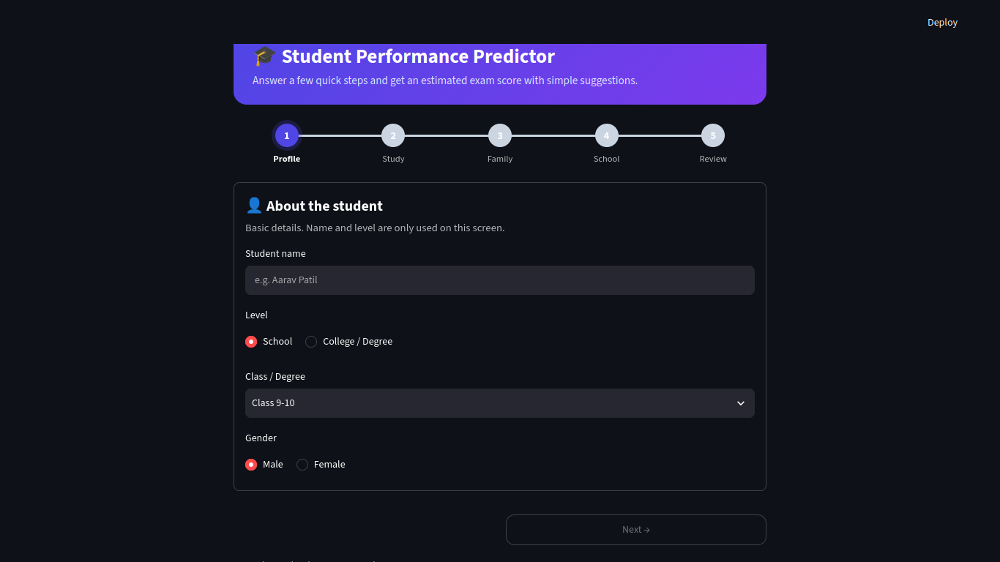
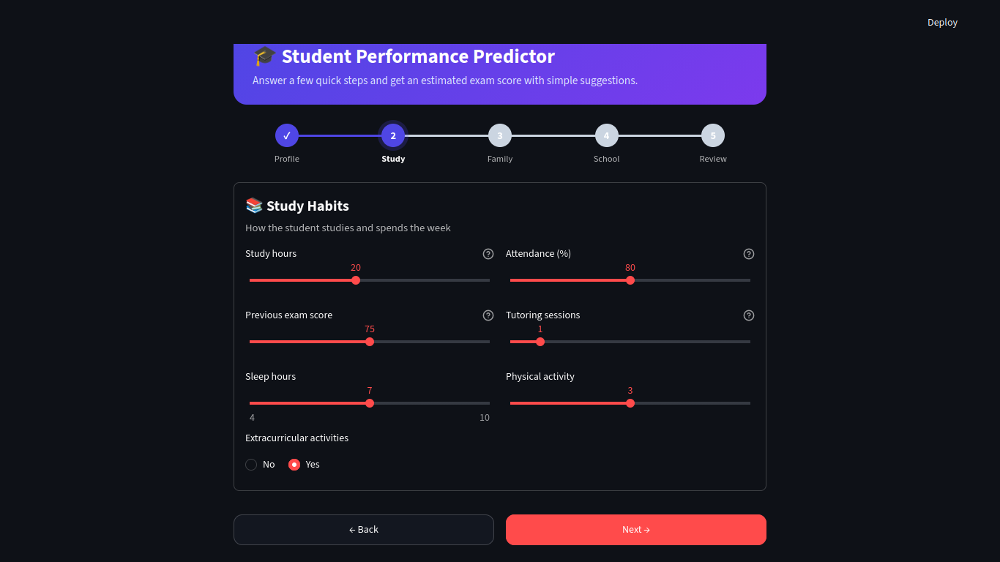
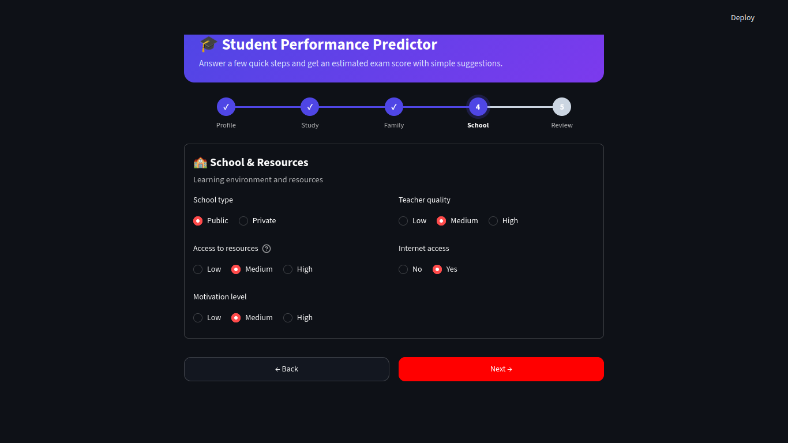

<div align="center">

# 🎓 Student Performance Prediction System

**Predict a student's exam score from study habits and background factors, and flag students who may need support.**


*AI / Machine Learning internship mini project*

</div>

---

## 📑 Table of Contents

1. [Overview](#-overview)
2. [Results at a Glance](#-results-at-a-glance)
3. [App Demo](#-app-demo)
4. [Features](#-features)
5. [Dataset](#-dataset)
6. [Workflow](#-workflow)
7. [Project Structure](#-project-structure)
8. [Getting Started](#-getting-started)
9. [Methodology](#-methodology)
10. [Results in Detail](#-results-in-detail)
11. [Limitations](#-limitations)
12. [Future Work](#-future-work)
13. [Troubleshooting](#-troubleshooting)
14. [Author](#-author)

---

## 🔎 Overview

Teachers can help students best when they know **early** who is likely to struggle. This project builds a complete Machine Learning workflow on student data:

- cleans and explores the data,
- trains and compares three regression models,
- selects the final model using cross-validation,
- evaluates it once on an unseen test set,
- and serves it through a **step-by-step Streamlit web app** that returns a predicted score and simple suggestions.

> **Goal:** predict `Exam_Score` and identify students whose predicted score is below a support threshold (65).

---

## 📊 Results at a Glance

| Metric (test set) | Value |
|---|---|
| **Final model** | Linear Regression (inside a preprocessing pipeline) |
| **R²** | **0.825** |
| **MAE** | **0.416** marks |
| **RMSE** | **1.521** marks |
| **At-risk students caught** (score below 65) | **297 of 297** (52 false alarms) |
| **Most important factors** | Attendance, Hours studied |

---

## 🖥️ App Demo

<!-- Add your own screenshots in an `assets/` folder and keep these file names, or edit the paths. -->

| 1. Profile | 2. Study habits |
|---|---|
|  |  |

| 3. Review | 4. Result |
|---|---|
|  |  |

---

## ✨ Features

- **Complete ML workflow:** data → cleaning → EDA → feature selection → training → testing → evaluation → prediction.
- **Leak-free preprocessing:** imputation, scaling and one-hot encoding live inside a Scikit-learn `Pipeline`, so test data and new students are treated exactly like training data.
- **Honest model selection:** the final model is chosen with 5-fold cross-validation on the training data. The test set is used only once, at the end.
- **Reality check:** the model is also retrained **without** `Previous_Scores` to see whether it only copies past marks (R² stays about 0.79).
- **At-risk detection:** students with a predicted score below 65 are flagged, with caught / missed / false-alarm counts.
- **Guided Streamlit app:** 5 steps (Profile, Study, Family, School, Review), progress stepper, edit-before-submit review page, colored result card and rule-based suggestions.

---

## 📚 Dataset

- **Name:** Student Performance Factors (Kaggle)
- **Size:** 6,607 rows × 20 columns (19 input features + target `Exam_Score`)
- **Features:** 6 numeric and 13 categorical
- **Missing values:** 235 in three categorical columns (`Teacher_Quality`, `Parental_Education_Level`, `Distance_from_Home`)
- **Download:** search **"Student Performance Factors"** on [Kaggle](https://www.kaggle.com/datasets) and place the CSV at `data/StudentPerformanceFactors.csv`.

<details>
<summary><b>Column overview</b></summary>

| Group | Columns |
|---|---|
| Study habits | `Hours_Studied`, `Attendance`, `Previous_Scores`, `Tutoring_Sessions`, `Sleep_Hours`, `Physical_Activity`, `Extracurricular_Activities` |
| Home & family | `Parental_Involvement`, `Parental_Education_Level`, `Family_Income`, `Distance_from_Home`, `Peer_Influence`, `Learning_Disabilities` |
| School & resources | `School_Type`, `Teacher_Quality`, `Access_to_Resources`, `Internet_Access`, `Motivation_Level` |
| Other | `Gender` |
| **Target** | `Exam_Score` |

</details>

> Dataset credit: add the dataset author and link from the Kaggle page here.

---

## 🔁 Workflow

```
Data → Cleaning → Analysis (EDA) → Feature Selection → Training → Testing → Evaluation → Prediction
```

| Stage | What was done |
|---|---|
| Cleaning | 0 duplicates; trimmed text; removed 1 row with an impossible score (101) |
| Missing values | Filled with mode (categorical) / median (numeric); safety imputers also inside the pipeline |
| EDA | Score distribution, correlation heatmap, numeric and categorical relationships |
| Feature selection | Correlation, category-wise score gaps, permutation importance |
| Training | Linear Regression, Random Forest, Gradient Boosting |
| Evaluation | R², MAE, RMSE, 5-fold cross-validation |
| Prediction | Saved pipeline + Streamlit app |

---

## 🗂️ Project Structure

```
student-performance-prediction/
├── data/
│   └── StudentPerformanceFactors.csv     # dataset (download from Kaggle)
├── visuals/                              # charts saved by the notebook/script
├── models/
│   ├── student_model.joblib              # trained pipeline
│   ├── metadata.json                     # form definition for the app
│   └── model_results.csv                 # model comparison table
├── app/
│   └── app.py                            # Streamlit app (step-by-step form)
├── assets/                               # app screenshots for this README
├── student_performance.ipynb             # full workflow (notebook)
├── student_performance.py                # same workflow as a script
├── requirements.txt
├── environment.yml                       # optional: conda environment export
└── README.md
```

---

## 🚀 Getting Started

### 1. Clone the repository

```bash
git clone https://github.com/<your-username>/student-performance-prediction.git
cd student-performance-prediction
```

### 2. Create the environment (Conda)

```bash
conda create -n student-ml python=3.11 -y
conda activate student-ml
conda install -c conda-forge pandas numpy matplotlib seaborn scikit-learn joblib streamlit jupyter -y
```

*Using pip instead?*

```bash
pip install -r requirements.txt
```

### 3. Add the dataset

Put `StudentPerformanceFactors.csv` inside the `data/` folder.

### 4. Train the model

Run **either** option from the project root:

```bash
# Option A: notebook
jupyter notebook          # open student_performance.ipynb and run all cells

# Option B: script
python student_performance.py
```

This creates the charts in `visuals/` and saves `models/student_model.joblib` and `models/metadata.json`.

> No display or Tk errors on your machine? Run `MPLBACKEND=Agg python student_performance.py`.

### 5. Launch the app

```bash
streamlit run app/app.py
```

The app opens in your browser. Fill the steps and press **Predict score**.

---

## 🧪 Methodology

**Train/test split.** 80 / 20 split (5,284 training rows, 1,322 test rows) with `random_state=42`.

**Preprocessing pipeline.**

| Step | Applied to | Purpose |
|---|---|---|
| `SimpleImputer(median)` | numeric columns | safety fill |
| `StandardScaler` | numeric columns | same scale |
| `SimpleImputer(most_frequent)` | categorical columns | safety fill |
| `OneHotEncoder` | categorical columns | text → 0/1 columns (19 inputs become 40) |

**Models.** Linear Regression (baseline), Random Forest, Gradient Boosting (also tuned with `GridSearchCV`).

**Model selection rule.** The final model is the one with the best **cross-validation** R² on the training data. A tuned Gradient Boosting model (CV R² 0.694) did not beat Linear Regression (CV R² 0.717), so Linear Regression was kept.

**Metrics.** R² (variance explained), MAE (average error in marks), RMSE (penalises large errors more).

---

## 📈 Results in Detail

### Model comparison

| Model | CV R² | Test R² | Test MAE | Test RMSE |
|---|---|---|---|---|
| **Linear Regression** | **0.717** | **0.825** | **0.416** | **1.521** |
| Gradient Boosting | 0.677 | 0.781 | 0.745 | 1.701 |
| Random Forest | 0.621 | 0.709 | 1.061 | 1.963 |

The simplest model won. The relationship between the features and the score in this dataset is mostly additive and close to linear, so complex models did not help.

### What matters most (permutation importance)

| Rank | Feature | Importance (drop in R²) |
|---|---|---|
| 1 | Attendance | 0.801 |
| 2 | Hours_Studied | 0.488 |
| 3 | Previous_Scores | 0.075 |
| 4 | Access_to_Resources | 0.075 |
| 5 | Parental_Involvement | 0.073 |
| 6 | Tutoring_Sessions | 0.055 |

### Key EDA findings

- **Attendance** (correlation 0.58) and **study hours** (0.45) have the strongest link with the score.
- `Sleep_Hours` and `Physical_Activity` show almost no linear relationship (about 0).
- Higher parental involvement goes with higher average scores (68.09 for High vs 66.33 for Low).
- `Gender` and `School_Type` make almost no difference.

### At-risk students (predicted score below 65)

| Actual at-risk | Caught | Missed | False alarms |
|---             |  ---   |        |              |
| 297            | 297    |    0   |       52     |

For a support-oriented use case, a false alarm is usually less harmful than a missed student. The threshold (65) is a project choice and can be changed.

---

## ⚠️ Limitations

- **The dataset looks curated or synthetic**, with very clean, near-linear patterns and a narrow score range (half of the students score between 65 and 69). Real-world performance is likely to be lower.
- **Correlation is not causation.** The model finds patterns; it does not prove what causes a score to change.
- **Limited features.** Health, stress, teaching quality in detail and exam difficulty are not captured.
- **Sensitive attributes** (gender, family income, learning disability) are in the data. Predictions should support teachers' judgement, never replace it or be used to treat students unfairly.
- The app's name, level and class/degree fields are for display only. The model is trained on school-level data, so results for college students are only a rough guide.
- Cross-validation R² (0.717) is lower than test R² (0.825). This gap was not investigated in depth.

---

## 🔮 Future Work

- Collect real data with a student survey and compare with this dataset.
- Investigate outliers and the CV vs test gap.
- Add a classification version (Low / Medium / High) with precision and recall.
- Add per-prediction explanations (for example SHAP).
- Deploy the app online and add batch prediction from a class list.

---

## 🛠️ Troubleshooting

| Problem | Fix |
|---|---|
| `FileNotFoundError: data/StudentPerformanceFactors.csv` | Put the CSV in `data/` and run commands from the **project root** folder. |
| `FileNotFoundError: models/student_model.joblib` (in the app) | The model is not trained yet. Run the notebook or `python student_performance.py` first. |
| `ModuleNotFoundError: No module named 'joblib'` (or pandas, sklearn) | Activate the environment (`conda activate student-ml`) and install the libraries again. |
| `conda is not recognized` (Windows) | Use **Anaconda Prompt** instead of CMD/PowerShell. |
| `tkinter ... main thread is not in main loop` | Harmless. Run with `MPLBACKEND=Agg python student_performance.py` to avoid it. |
| Jupyter uses the wrong Python | Run `python -m ipykernel install --user --name student-ml` and select that kernel. |

---

## 👤 Author

**Sameer**

- GitHub: [github.com/SameerShaikhDev](https://github.com/SameerShaikhDev)
- LinkedIn: [linkedin.com/in/shaikh-sameer-2566b23ba](https://www.linkedin.com/in/shaikh-sameer-2566b23ba)

Built as part of an AI / Machine Learning internship mini project. Feedback and suggestions are welcome.

---

<div align="center">

If you found this project useful, consider giving it a ⭐

</div># Student-Prediction-System
# Student-Prediction-System
# Student-Prediction-System
# Student-Prediction-System
